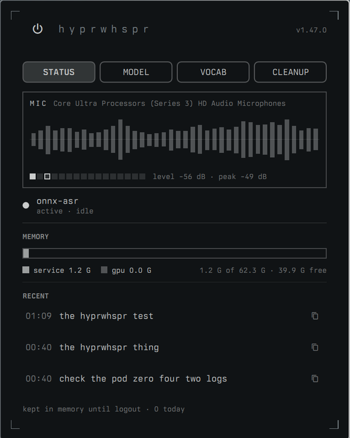
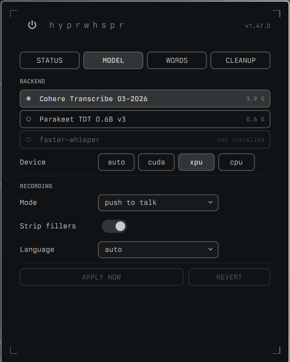
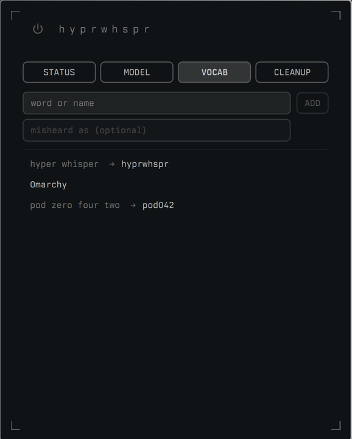
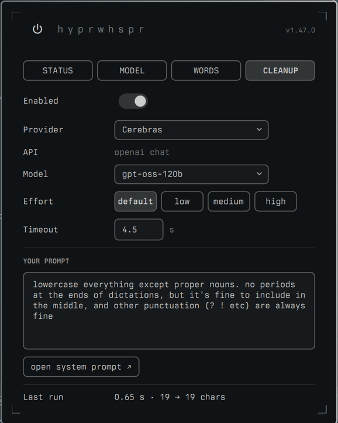
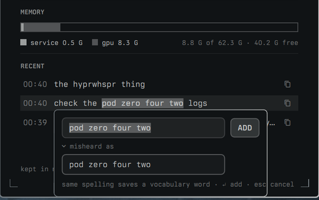

# omarchy-hyprwhspr

An [Omarchy](https://omarchy.org) bar widget and panel for [hyprwhspr](https://github.com/goodroot/hyprwhspr) dictation: a live mic check, the last few transcripts, model switching, vocabulary, and LLM cleanup of what you said before it gets typed.

| Status | Model | Vocab | Cleanup |
| --- | --- | --- | --- |
|  |  |  |  |

## Prerequisites

- **hyprwhspr**, installed and set up, with its user service running:

  ```sh
  yay -S hyprwhspr
  hyprwhspr setup
  systemctl --user status hyprwhspr
  ```

  The panel reads and edits the `~/.config/hyprwhspr/config.json` that setup writes.

- **cava**, for the mic check spectrum: `sudo pacman -S cava`. Without it the spectrum stays empty and the rest works.

Everything else it calls (`pw-record`, `wl-copy`, `jq`, and Python) already comes with Omarchy and hyprwhspr.

## Install

```sh
omarchy plugin add https://github.com/thurstonsand/omarchy-hyprwhspr.git --enable
```

Update it with `omarchy plugin update thurstonsand.hyprwhspr`.

The widget sits on the bar as a microphone. It stays dim while the model is unloaded, brightens when it is loaded, and lights up while recording. Click it to open the panel.

## The panel

### Status

- **Mic check.** A live spectrum of the default input, running whenever the panel is open, whether or not hyprwhspr is recording. If the bars move when you talk, hyprwhspr can hear you.
- **Memory.** What the service and its GPU allocations are holding.
- **Recent.** The last three transcripts, each with a copy button, for when a paste lands in the wrong window. Long transcripts scroll within their row. Select text in a row to teach a word (see Vocab). These live in `$XDG_RUNTIME_DIR` and are gone at logout.
- **Power.** The button beside the title loads or unloads the model, and pulses while it wakes. Right-click it to set the auto-hibernate timer.

### Model

Pick the transcription backend, device, recording mode, and language. hyprwhspr only reads its config at startup, so changes are applied with one service restart, either from **Apply now** or automatically when you leave the tab or close the panel. Right-click a downloaded model to remove its files.

### Vocab

Teach hyprwhspr uncommon words and proper nouns.

- A **word** on its own is vocabulary: a spelling cleanup should prefer.
- A word with **misheard as** is a correction: whenever hyprwhspr hears the misheard phrase, it types the word instead.



Entries are stored as hyprwhspr's own `word_overrides`, so they keep working with the panel uninstalled. Corrections are plain text replacements: whole words, case-insensitive, longest phrase first. They don't bias the transcription model itself. Saving restarts the service, the same as the Model tab.

### Cleanup

Send each transcript to an LLM that removes filler, applies spoken punctuation and backtracks, and uses your vocabulary spellings, before hyprwhspr types it. Groq, Cerebras, OpenAI, and Anthropic are built in. **Add provider** takes any URL and detects whether it speaks OpenAI chat completions, OpenAI responses, or Anthropic messages. Models are listed from the provider.

Your prompt is added on top of a built-in system prompt. To change the built-in one, **open system prompt** copies it to `~/.config/hyprwhspr/system.md`, which takes precedence from then on.

If cleanup fails or exceeds hyprwhspr's 5 second hook limit, the raw transcript is typed instead.

To enable cleanup, point hyprwhspr's hook at the plugin in `~/.config/hyprwhspr/config.json`:

```json
"post_transcription_hook": "~/.config/omarchy/plugins/thurstonsand.hyprwhspr/bin/cleanup"
```

then `systemctl --user restart hyprwhspr`.

The hook runs inside the hyprwhspr service, so built-in providers read their key (`GROQ_API_KEY`, `CEREBRAS_API_KEY`, `OPENAI_API_KEY`, `ANTHROPIC_API_KEY`) from its environment. A custom provider can name its own variable, or take a pasted key, which is saved to `~/.config/hyprwhspr/keys/<provider>` with mode 600. To set a variable, add a systemd drop-in:

```ini
# ~/.config/systemd/user/hyprwhspr.service.d/keys.conf
[Service]
Environment=CEREBRAS_API_KEY=...
```

then `systemctl --user daemon-reload && systemctl --user restart hyprwhspr`.

## Files

| Path | Contents |
| --- | --- |
| `~/.config/hyprwhspr/config.json` | hyprwhspr's config. The panel edits model fields and `word_overrides` in place. |
| `~/.config/hyprwhspr/panel.json` | Cleanup settings and custom providers. Written in place, so it can be a symlink into your dotfiles. |
| `~/.config/hyprwhspr/system.md` | Optional override of the built-in cleanup prompt. |
| `~/.config/hyprwhspr/keys/` | Pasted API keys. |
| `~/.local/state/hyprwhspr/cleanup.jsonl` | Timings and errors of the last 500 cleanup runs. No transcript text. |
| `$XDG_RUNTIME_DIR/hyprwhspr/recent.json` | The last three transcripts. |

## License

MIT
